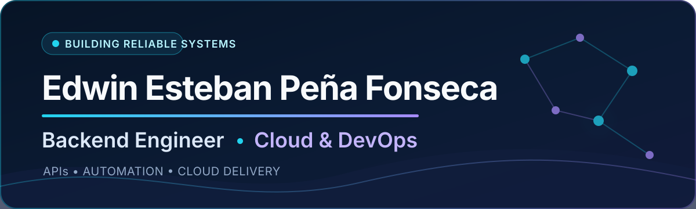

# Edwin Esteban Peña Fonseca

  <a href="#english"><strong>English</strong></a> ·
  <a href="#espanol"><strong>Español</strong></a>

## 👋 Backend Engineer | Cloud & DevOps

I am a backend engineer with **3+ years of software development experience**, based in **El Rosal, Cundinamarca, Colombia**, and open to remote work. I build reliable APIs, automate operational workflows, improve data-intensive systems, and support software delivery with cloud and DevOps practices.

> **Availability:** Open to remote opportunities · **English:** Limited working proficiency, primarily reading and writing

### ⚡ Measurable impact

- **+30% team productivity** by automating recurring workflows with Python.
- **-20% PostgreSQL query response time** through query optimization and indexing.
- Digitized spreadsheet-based and manual workflows into relational database applications.

### 🧰 Core stack

#### Professional experience

     

#### Hands-on and project experience

  

Microservices and event-driven systems are also part of my hands-on and project experience. Additional working knowledge includes **Java, JavaScript/TypeScript, C#, and SQL/NoSQL databases**.

### 🚀 Featured projects

#### [GeoKapti Microservices][geokapti]

> Flask microservices for geospatial location registration and Haversine distance calculation. Built with **Redis, RabbitMQ, Docker Compose, and OpenAPI**.

#### [Go Authentication API][go-auth]

> A Go REST API with **JWT authentication, PostgreSQL, layered architecture, Docker Compose, and Swagger**. The link retains the repository's existing `prueba_tecnica_BRM` name.

### 🌱 Current work and education

I am developing **Pilum**, a backend framework for Dart built around AOT compilation, compile-time code generation, and zero reflection. It applies Clean Architecture, SOLID, and dependency inversion, with reusable components for routing, middleware, validation, authentication, caching, and responses. Pilum does not currently have a public repository URL.

I continue building project experience with Go, AWS, microservices, and event-driven systems. I am pursuing a **Bachelor of Commercial Software Engineering at Jala University**, from **July 2025** to an expected graduation in **August 2029**.

### ✉️ Contact

[LinkedIn][linkedin] · [GitHub][github] · [estebanfonsecadev@gmail.com][email]

---

<strong>🇨🇴 Español — ver perfil completo</strong>

## 👋 Ingeniero Backend | Cloud y DevOps

Soy ingeniero backend con **más de 3 años de experiencia en desarrollo de software**. Vivo en **El Rosal, Cundinamarca, Colombia**, y estoy disponible para trabajo remoto. Desarrollo APIs confiables, automatizo flujos de trabajo operativos, mejoro sistemas con uso intensivo de datos y apoyo la entrega de software con prácticas de nube y DevOps.

> **Disponibilidad:** Abierto a oportunidades de trabajo remoto · **Inglés:** Competencia laboral limitada, principalmente para lectura y escritura

### ⚡ Impacto medible

- **+30% de productividad del equipo** mediante la automatización de flujos de trabajo recurrentes con Python.
- **-20% en el tiempo de respuesta de consultas PostgreSQL** mediante optimización de consultas e indexación.
- Digitalicé procesos basados en hojas de cálculo y tareas manuales mediante aplicaciones con bases de datos relacionales.

### 🧰 Tecnologías principales

#### Experiencia profesional

     

#### Experiencia práctica y en proyectos

  

Los microservicios y los sistemas orientados a eventos también forman parte de mi experiencia práctica y en proyectos. Mis conocimientos de trabajo adicionales incluyen **Java, JavaScript/TypeScript, C# y bases de datos SQL/NoSQL**.

### 🚀 Proyectos destacados

#### [Microservicios GeoKapti][geokapti]

> Microservicios Flask para el registro de ubicaciones geoespaciales y el cálculo de distancias con la fórmula de Haversine. Desarrollados con **Redis, RabbitMQ, Docker Compose y OpenAPI**.

#### [API de autenticación en Go][go-auth]

> API REST en Go con **autenticación JWT, PostgreSQL, arquitectura por capas, Docker Compose y Swagger**. El enlace conserva el nombre existente del repositorio `prueba_tecnica_BRM`.

### 🌱 Trabajo actual y educación

Estoy desarrollando **Pilum**, un framework backend para Dart basado en compilación AOT, generación de código en tiempo de compilación y cero reflexión. Aplica Clean Architecture, SOLID e inversión de dependencias, con componentes reutilizables para enrutamiento, middleware, validación, autenticación, caché y respuestas. Pilum no tiene actualmente una URL de repositorio público.

Continúo desarrollando experiencia mediante proyectos con Go, AWS, microservicios y sistemas orientados a eventos. Curso el **Bachelor of Commercial Software Engineering en Jala University**, desde **julio de 2025** hasta la fecha estimada de graduación en **agosto de 2029**.

### ✉️ Contacto

[LinkedIn][linkedin] · [GitHub][github] · [estebanfonsecadev@gmail.com][email]

[geokapti]: https://github.com/Estebanfonseca/geokapti_microservices
[go-auth]: https://github.com/Estebanfonseca/prueba_tecnica_BRM
[linkedin]: https://www.linkedin.com/in/edwin-esteban-pena-fonseca/
[github]: https://github.com/Estebanfonseca
[email]: mailto:estebanfonsecadev@gmail.com
